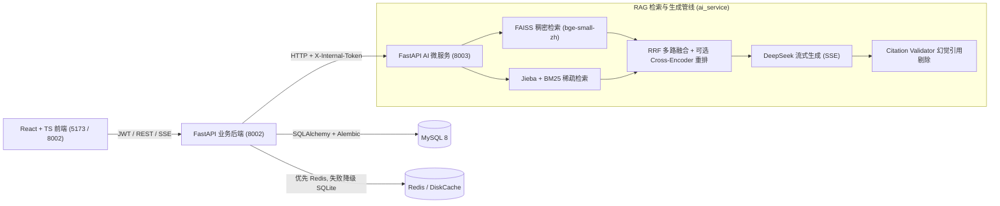

# CampusQA

[](https://github.com/Nanoda16/CampusQA/actions/workflows/ci.yml)
[](https://www.python.org/)
[](frontend/)
[](LICENSE)

面向高校知识库场景的全栈 RAG 智能问答系统：**React + TypeScript 前端**、**FastAPI 业务后端**、**FastAPI AI 检索微服务**。采用 **FAISS 稠密向量 + BM25 稀疏关键词 + RRF 融合检索**，支持真 SSE 流式输出、多轮对话指代消解、引用来源后校验、以及 Redis → 本地 SQLite 持久化缓存降级。

---

## 系统架构



---

## 核心功能与工程特性

- **混合检索与引用溯源**：Dense（FAISS）+ Sparse（BM25）经 RRF 融合排序，支持多轮对话上下文与回答末尾 `[Sx]` 引用后校验（自动剔除越界幻觉引用）。
- **真 SSE 实时流式输出**：AI 服务与业务后端端到端实时透传 token，首字响应快，前端兼容 CRLF 与 AbortController 取消，并在结束事件使用服务端清洗后的最终回答落库。
- **知识目录单一事实源**：`knowledge_docs/` 统一管理语料，支持界面上传 PDF/DOC/DOCX/TXT 流式分块限额解析入库，并可一键全量重建索引且自动对齐 MySQL 记录。
- **安全与权限控制**：JWT 鉴权实时校验数据库用户状态与角色；公开注册强制 `student` 角色防垂直越权；会话详情/反馈/文档更新均强制归属权校验防 IDOR；AI 微服务支持 `INTERNAL_API_TOKEN` 与文件路径白名单；静态页 SPA 回退严格校验目录边界。
- **高可用缓存降级**：优先连接 Redis，不可用时自动无缝降级为线程安全的本地 SQLite `DiskCache`。

---

## RAG 检索评测与消融发现

基于 340 篇校园公开文档（2,017 个切片）与 50 条自建评测集（40 条可答 + 10 条域外 OOD），对比了混合检索与 Cross-Encoder 重排效果：

| 配置 | Hit@5 | MRR@5 | 平均检索延迟 | 结论 |
| :--- | ---: | ---: | ---: | :--- |
| **Hybrid（Dense + BM25 + RRF，默认）** | **0.725 (29/40)** | **0.6425** | **0.295 s** | 默认生产配置 |
| Hybrid + Cross-Encoder（公平 top-5） | 0.725 (29/40) | 0.5500 | 1.021 s | 延迟增至 3.5x 且 MRR 略降，故默认关闭 |

> **关键工程复盘**：
> 1. 通过公平消融排查发现，早期测得“重排降低 Hit@5”系候选窗口不对称（top-5 vs top-3）叠加 `doc_id` 键覆盖多 chunk 分数所致；修正后同池对比确认关闭重排更优。
> 2. OOD 域外阈值扫描表明：可答问题相似度区间 `[0.544, 0.831]` 与域外问题 `[0.626, 0.745]` 高度重叠，仅靠单标量向量相似度难以兼顾低误拒与低漏拒，后续演进方向为多信号融合（BM25 覆盖率 + 分类器）。

---

## 快速开始

环境要求：Python 3.11+、Node.js 20.19+、MySQL 8（Redis 可选）。

### 1. 配置环境变量

```bash
cp ai_service/.env.example ai_service/.env   # 填入 DEEPSEEK_API_KEY
cp backend/.env.example backend/.env         # 填入 MySQL 连接参数与强随机 JWT_SECRET_KEY
```

### 2. 初始化数据库并启动服务

```sql
CREATE DATABASE IF NOT EXISTS campus_qa DEFAULT CHARSET utf8mb4;
```

```bash
# 1) AI 微服务（端口 8003）
cd ai_service
pip install -r requirements.txt
python -m uvicorn main:app --host 127.0.0.1 --port 8003

# 2) 业务后端（端口 8002）
cd backend
pip install -r requirements.txt
python -m uvicorn app.main:app --host 127.0.0.1 --port 8002

# 3) 前端开发服务（端口 5173）
cd frontend
npm install
npm run dev
```

访问 http://localhost:5173 ，API 文档在 http://localhost:8002/docs 。如需单端口运行，可先在 `frontend/` 执行 `npm run build`，后端会自动托管静态产物（http://localhost:8002 ）。

### 3. 运行自动化测试

```bash
# 后端安全与核心 API 单元测试（基于内存 SQLite，零外部依赖）
python -m pytest backend/tests -q

# AI 引擎核心单元测试（离线运行，无需下载大模型权重）
python -m pytest ai_service/tests -q

# 前端类型检查与生产构建
cd frontend && npm run build
```

---

## 目录结构

```text
├── .github/workflows/ci.yml  # 后端 + AI 引擎 + 前端三路 CI
├── ai_service/               # AI 微服务（8003）：FAISS + BM25 + RRF + DeepSeek
│   ├── main.py
│   ├── engine/               # loader / chunker / embedding / vector_store / bm25 / fusion / citation
│   └── tests/                # AI 引擎单元测试
├── backend/                  # 业务后端（8002）：认证、权限、文档、问答、缓存管理
│   ├── app/                  # deps / routers / services / models / schemas / cache
│   ├── alembic/              # 数据库迁移脚本
│   └── tests/                # 后端安全与业务 API 单元测试
├── frontend/                 # React 19 + TypeScript + Vite + Tailwind 前端
├── knowledge_docs/           # 知识库目录（唯一事实源）
└── LICENSE
```

## License

[MIT](LICENSE)
