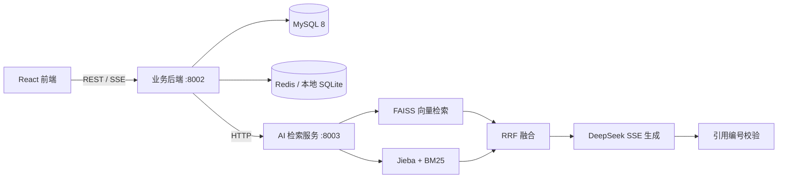

# DocQA

[](https://github.com/Nanoda16/docqa/actions/workflows/ci.yml)
[](https://www.python.org/)
[](LICENSE)

一个通用文档知识库问答系统。前端用 React + TypeScript，后端拆成两个 FastAPI 服务：业务后端负责账号、文档管理和会话持久化，AI 服务负责文档切片、混合检索和流式生成。

## 整体结构



主要特性：

- 混合检索：FAISS（`bge-small-zh-v1.5`）和 BM25 分别召回候选片段，用 RRF 做融合排序，生成后校验 `[Sx]` 引用编号，剔除越界引用。
- 实时流式问答：AI 服务和业务后端逐 token 透传 SSE，支持多轮历史上下文和中途取消。
- 文档管理：以数据库文档列表为唯一数据源，支持网页端上传 PDF / DOCX / TXT / MD（请求内即时提取文本）或新建纯文本文档；增删改与向量化彻底解耦，支持增量同步索引（仅处理新增、修改或删除的文档，跳过未变动内容）与全量重建。
- 账号与缓存：支持 `user`（普通用户）/ `editor`（编辑者）/ `admin`（管理员）三级角色，系统首次注册的账号自动成为管理员，管理员可在后台管理用户角色、状态与重置密码；JWT 鉴权实时校验账号状态和角色，问答缓存优先走 Redis，本机没装 Redis 时自动退回本地 SQLite 文件缓存。

## 检索评测记录

本地用 340 篇中文公开文档（切分后 2,017 个文本块）和 50 道测试题（40 道可答 + 10 道域外问题）跑了一轮检索对比：

| 方案 | Hit@5 | MRR@5 | 平均检索耗时 |
| :--- | ---: | ---: | ---: |
| Dense + BM25 + RRF（当前默认） | 0.725 (29/40) | 0.6425 | 0.295 s |
| 上述方案 + Cross-Encoder 重排（同池 top-5） | 0.725 (29/40) | 0.5500 | 1.021 s |

几点实际测出来的结论：

- 最初加了 Cross-Encoder 重排，但公平对比同一候选池后发现 Hit@5 没涨，MRR 反而略降，耗时还增加了 3.5 倍，所以线上配置默认关闭重排。
- 域外拒答单靠向量相似度阈值行不通：实测可答问题相似度落在 `[0.544, 0.831]`，域外问题在 `[0.626, 0.745]`，重叠严重。只调高阈值会误杀大量正常提问，这部分后续打算引入 BM25 词项覆盖率等多信号一起判断。

## 本地运行

需要 Python 3.11+、Node.js 20.19+、MySQL 8（Redis 可选）。

### 1. 准备配置和数据库

复制环境变量模板并填入自己的配置：

```bash
cp ai_service/.env.example ai_service/.env
cp backend/.env.example backend/.env
```

`ai_service/.env` 需要填 `DEEPSEEK_API_KEY`，`backend/.env` 填 MySQL 连接信息和 `JWT_SECRET_KEY`。如果部署在非本机环境，建议在两边配同一个 `INTERNAL_API_TOKEN`。

在 MySQL 里建空库，后端首次启动会自动建表（老库升级在 `backend/` 下跑 `alembic upgrade head`）：

```sql
CREATE DATABASE IF NOT EXISTS doc_qa DEFAULT CHARSET utf8mb4;
```

### 2. 启动三个进程

```bash
# AI 服务 (8003)
cd ai_service
pip install -r requirements.txt
python -m uvicorn main:app --host 127.0.0.1 --port 8003

# 业务后端 (8002)
cd backend
pip install -r requirements.txt
python -m uvicorn app.main:app --host 127.0.0.1 --port 8002

# 前端 (5173)
cd frontend
npm install
npm run dev
```

打开 http://localhost:5173 即可使用，后端 Swagger 文档在 http://localhost:8002/docs 。

如果不想开三个终端，可以先在 `frontend/` 执行 `npm run build`，再直接运行根目录的 `start.bat` 或 `start.ps1`。后端检测到 `frontend/dist` 存在时会自动托管静态页面，直接访问 http://localhost:8002 。

### 3. 导入知识库

仓库本身不带语料文件。首次打开网页先注册首个管理员账号，然后进入「知识库文档」页面上传 PDF / DOCX / TXT / MD 文件或直接新建纯文本文档（即时解析存入数据库）。文档准备就绪后，点击页面顶部的「同步索引」（仅对新增、修改或删除的文档做增量更新）或「全量重建」，同步完成后即可在「智能问答」中基于最新知识库进行检索与问答。

## 测试

后端和 AI 引擎的核心测试都是离线运行的，不依赖外部 MySQL 或大模型 API：

```bash
python -m pytest backend/tests -q
python -m pytest ai_service/tests -q
cd frontend && npm run build
```

## 目录说明

```text
├── ai_service/        # 检索与生成服务（切片、FAISS、BM25、RRF、引用校验）
├── backend/           # 业务后端（账号权限、文档管理、问答记录、缓存）
│   └── alembic/       # 数据库迁移脚本
├── frontend/          # React + TypeScript + Vite 前端
└── .github/workflows/ # 后端、AI 服务、前端三路 CI
```

## License

[MIT](LICENSE)
